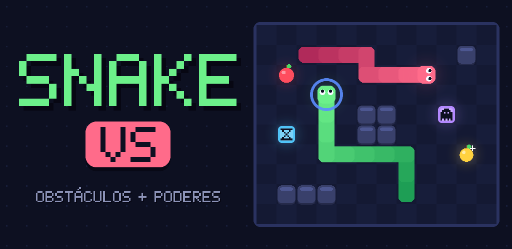

# Snake VS

Snake clássico com obstáculos e poderes, feito em C# com MonoGame. Alvo principal: Android (Google Play).



## O jogo

- **Clássico**: 8 maçãs por nível. Cada nível novo traz obstáculos e mais velocidade (níveis 1-5 desenhados à mão, depois gerados por semente).
- **VS CPU**: duelo contra uma cobra da CPU (busca em largura + flood fill para não se encurralar). Ganha quem chegar a 15 maçãs ou sobreviver.
- **Poderes**: Lento, Fantasma (atravessa tudo), Pontos x2, Tesoura (corta a cauda), Escudo (salva de uma batida) e Maçã dourada (+50).
- **Controles**: deslizar (padrão) ou botões na tela; teclado/gamepad no desktop.
- **Opções**: dificuldade (Fácil/Normal/Difícil), som, vibração, tipo de controle. Recordes salvos no aparelho.
- **Idiomas**: Português (Brasil) e Inglês, escolhidos pelo idioma do sistema.

## Estrutura

```
src/
  SnakeVs.Core/      regras do jogo puras em C# (sem MonoGame): sessão, cobra, IA, níveis, save
  SnakeVs.Game/      código MonoGame compartilhado (render, fonte pixel, input, áudio, telas)
  SnakeVs.Android/   app Android (Activity, manifest, ícones, assinatura, AAB)
  SnakeVs.Desktop/   build desktop para desenvolvimento, capturas automáticas e arte da loja
tests/
  SnakeVs.Core.Tests/  testes xUnit (regras, colisões, poderes, níveis, IA, save, simulação em massa)
store/               textos da loja, política de privacidade, ícone, destaque e capturas de tela
docs/                padrão visual (STYLE.md) e guia de publicação (PUBLISHING.md)
scripts/             criação da chave de upload e build do AAB assinado
```

O jogo não usa content pipeline: texturas, fonte, ícones e sons são gerados em código. Isso deixa o build simples
e o APK leve.

## Comandos

```powershell
dotnet test                                                    # testes
dotnet run --project src/SnakeVs.Desktop                       # jogar no PC
dotnet run --project src/SnakeVs.Desktop -- --tour shots       # captura todas as telas em 4 resoluções
dotnet run --project src/SnakeVs.Desktop -- --store-art art    # gera ícones Android e gráficos da loja
./scripts/create-keystore.ps1                                  # chave de upload (uma vez)
./scripts/build-android.ps1                                    # testes + AAB assinado em artifacts/android
```

Publicação passo a passo: [docs/PUBLISHING.md](docs/PUBLISHING.md). Padrão visual: [docs/STYLE.md](docs/STYLE.md).

## Requisitos

.NET SDK 10 com workload `android`, Android SDK (plataforma 36) e JDK 17+.
